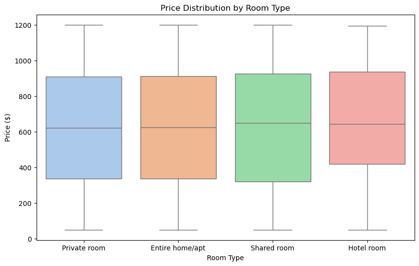
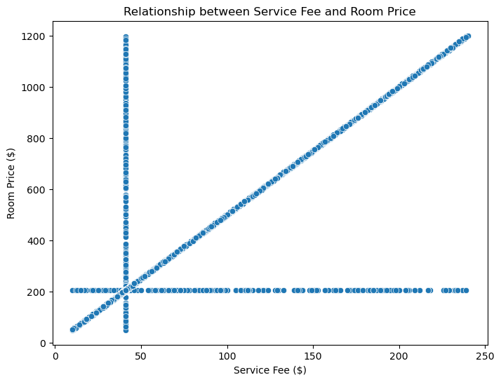
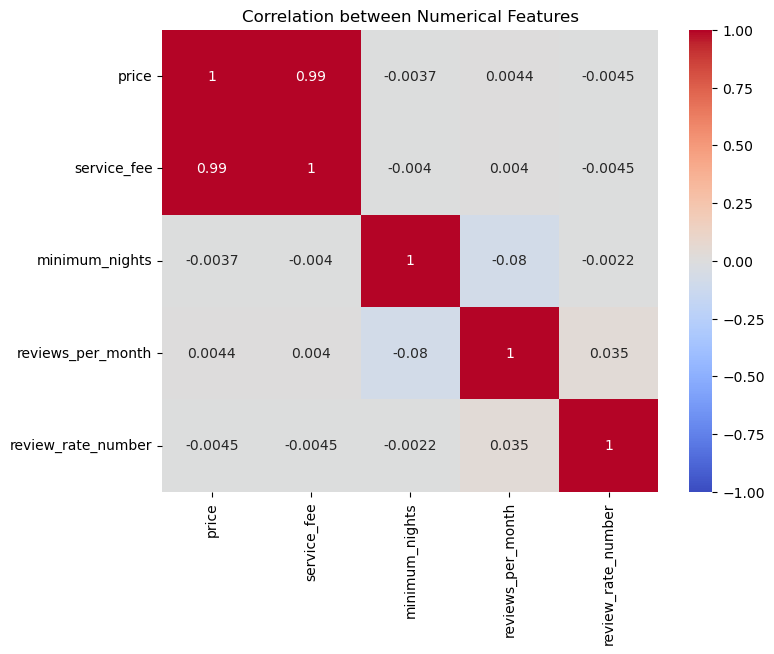

# Airbnb New York City - Exploratory Data Analysis


**Final Capstone Project** | IBM Programme in Data Analytics 

---

## 📋 Project Overview

This project presents a complete **Exploratory Data Analysis (EDA)** of the Airbnb market in New York City. Starting from a raw dataset, the analysis includes data cleaning, preprocessing, visualization, and the extraction of meaningful business insights regarding pricing patterns, room types, and neighbourhood performance.

---

## 🎯 Objectives

- Assess data quality and perform thorough cleaning (missing values, duplicates, inconsistencies)
- Standardize column names and data formats
- Analyze pricing dynamics across room types and boroughs
- Identify the most active and profitable neighbourhoods
- Extract actionable insights for hosts and market stakeholders

---

## 🛠 Tools & Technologies

- **Python**
- **Pandas** & **NumPy** — Data manipulation
- **Matplotlib** & **Seaborn** — Data visualization
- **Jupyter Notebook**

---

## Reproducing the notebook

The saved notebook was created with Python 3.12. Install the analysis and notebook dependencies:

```bash
python -m venv .venv
# Windows: .venv\Scripts\activate
# macOS/Linux: source .venv/bin/activate
python -m pip install -r requirements.txt
python -m notebook
```

Open `ibm-final-project-airbnb-data-analysis.ipynb`. The input CSV is not included
in this repository. Supply `Airbnb_Open_Data.csv` from the dataset used for the
project and change `data_path` in the first code cell to your local file path
before running all cells. The saved outputs can be inspected without the CSV.
The dependency ranges are not a lockfile and do not reproduce the original environment exactly.

---

## 📈 Key Insights

- **Queens** surprisingly shows the highest average listing price, followed by Bronx and Brooklyn.
- Price differences across boroughs are relatively small, so this result should be interpreted with caution and may reflect dataset limitations rather than actual market pricing.
- **Entire homes/apartments** are significantly more expensive than private and shared rooms.
- Extremely strong positive correlation (**~0.99**) between `price` and `service_fee`. This is consistent with a fee calculated as a near-fixed percentage of price, which would generate the correlation mechanically. The notebook does not verify the fee formula; this should not be treated as an independent market insight or a causal pricing driver.
- Listings are heavily concentrated in a few popular neighbourhoods (Williamsburg, Bedford-Stuyvesant, Harlem, etc.).
- The dataset was relatively clean after preprocessing, with no extreme price outliers detected.

---


## Selected charts

These figures are extracted unchanged from the notebook's saved outputs. They
show the existing analysis, not a new execution against the source dataset.

### Price distribution by room type



### Service fee and listing price



The near-linear relationship could arise from calculating the fee from the
price. The formula is not established here, so this chart does not demonstrate
an independent market effect.

### Numerical correlations



These are descriptive associations in the processed dataset. They do not
establish causation or demonstrate that the sample represents current NYC prices.

---

## 📜 Certification

**IBM Programme Data Analytics** - Final Project


[View Credly Badge](https://www.credly.com/badges/94cd09c5-fbca-466d-b6a5-b38ac423fbeb/linked_in?t=s3wbqe)

---

## License

The author's original code, notebook, and written analysis are licensed under
the [MIT License](LICENSE). External datasets and the IBM certificate
(`certificate.png`), including third-party names, logos, and trademarks, are
excluded from this grant and remain subject to their respective owners' terms.
No external dataset is bundled with this repository.

---

## 👤 Author

**Alessandro Benevelli**

---

**Feel free to explore the notebook and reach out if you have any questions!**
